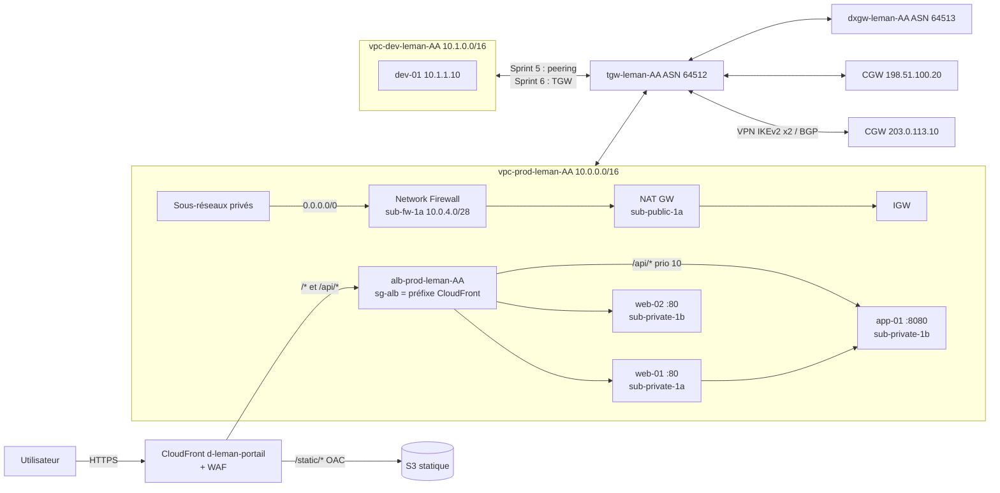

# TP final : portail Léman Finance en infrastructure as code

**Projet** : SatomCloudNetwork · **Client fictif** : Groupe Léman Finance SA
**Auteure** : Alexandra Assaga (équipe `Assaga`, suffixe `-AA`)
**Langage IaC** : AWS CloudFormation · **Région** : `eu-central-2` (Zurich)

> Ce guide accompagne le dépôt `satom-leman-portail`. Chaque sprint indique : l'objectif, les fichiers à livrer, le déploiement, le contrôle de sécurité, la mesure, la preuve à déposer et le coût à surveiller.
> Les résultats de mesure ne sont **pas** pré-remplis : ils se notent dans `docs/journal.md` après chaque test réel.

[TOC]

---

## 0. Vue d'ensemble

### 0.1 Architecture



### 0.2 Découpage en stacks

| Stack | Template | Région | Sprints |
|---|---|---|---|
| `stack-leman-bootstrap` | `bootstrap/github-oidc.yaml` | eu-central-2 | 13 (déployée une seule fois, à la main) |
| `stack-leman-shared-budget` | `00-budget.yaml` | **us-east-1** | Cadrage (150 CHF, alerte 80 %) |
| `stack-leman-shared-account` | `00-account.yaml` | eu-central-2 | 12 (GuardDuty, Security Hub, Config) |
| `stack-leman-<env>-base` | `01-base.yaml` | eu-central-2 | Clé KMS de l'environnement |
| `stack-leman-<env>-network` | `02-network.yaml` | eu-central-2 | 1, 2, 3 (NACL), 4 |
| `stack-leman-<env>-security` | `03-security.yaml` | eu-central-2 | 3, 11 |
| `stack-leman-<env>-compute` | `04-compute.yaml` | eu-central-2 | 2, 3, 5 (instances de mesure) |
| `stack-leman-shared-interconnect` | `05-interconnect.yaml` | eu-central-2 | 5, 6 |
| `stack-leman-shared-hybrid` | `06-hybrid.yaml` | eu-central-2 | 7, 8 |
| `stack-leman-shared-edge-global` | `07-edge-global.yaml` | **us-east-1** | 10 (zone publique, DNSSEC), 11 (WAF) |
| `stack-leman-<env>-edge` | `08-edge.yaml` | eu-central-2 | 9, 10, 11 |
| `stack-leman-<env>-monitoring` | `09-monitoring.yaml` | eu-central-2 | 12 |

**Pourquoi plusieurs stacks par environnement plutôt qu'une seule `stack-leman-dev` ?**
1. Le budget : on peut supprimer une stack coûteuse sans toucher au reste.
2. Certaines ressources doivent être en `us-east-1` (Budgets, WAF CloudFront, clé DNSSEC), et une stack ne vit que dans une région.
3. Une erreur de déploiement est isolée.

Toutes les stacks d'un environnement portent le préfixe `stack-leman-<env>-` et sont créées par le même script, à partir des mêmes templates.

### 0.3 Plan d'adressage

| Sous-réseau | prod | dev | AZ |
|---|---|---|---|
| sub-public-1a | 10.0.0.0/24 | 10.1.0.0/24 | a |
| sub-private-1a | 10.0.1.0/24 | 10.1.1.0/24 (dev-01 = 10.1.1.10) | a |
| sub-private-1b | 10.0.2.0/24 | 10.1.2.0/24 | b |
| sub-fw-1a | **10.0.4.0/28** | 10.1.4.0/28 | a |
| sub-public-1b | **10.0.5.0/24** | 10.1.5.0/24 | b |

Les valeurs en gras sont imposées par le sujet. Les autres sont à aligner sur ton plan des modules précédents si besoin (`parameters/*.json`).

### 0.4 Adaptations au sujet, à justifier dans le rapport

| Point du sujet | Choix retenu | Raison |
|---|---|---|
| `sg-app` : 8080 depuis `sg-web` uniquement | 8080 depuis `sg-web`, `sg-alb` et le CIDR homologue | La règle ALB `/api/*` vers `tg-app` et la mesure du sprint 5 (dev-01 → app-01:8080) l'exigent |
| `sg-web` : 443 ouvert | 443 et 80 ouverts **depuis l'ALB uniquement** | Au sprint 11, l'ALB n'accepte que CloudFront, donc les serveurs web n'ont pas à être exposés |
| Accès admin | SSM Session Manager, aucune clé SSH, port 22 fermé partout | Zéro port d'administration exposé (seuil = 0) |
| 2 serveurs web | `web-01` (AZ a) + `web-02` (AZ b) | Mesurer une vraie bascule au sprint 9 |
| Domaine fictif `.example` | Certificats ACM non validables → origine CloudFront → ALB en HTTP (port 80 limité au préfixe CloudFront) et certificat `*.cloudfront.net` | **À valider avec le formateur** (voir §6) |
| Tunnels VPN « UP » | Passerelles client fictives (plages de documentation) : tunnels DOWN, métrique `TunnelState` = 0 visible | **À valider** : variante strongSwan possible (voir sprint 7) |
| Budget en CHF | AWS Budgets fonctionne en USD : 150 CHF convertis au taux du jour | Contrainte du service |

---

## 1. Phase 0 : préparation (avant le sprint 1)

### 1.1 Outils

Sur le PC Windows (PowerShell) :
```powershell
git --version
gh --version
aws --version          # AWS CLI v2
python --version       # 3.10+
pip install cfn-lint checkov
```
Les scripts `scripts/*.sh` et `tests/*.sh` sont en bash. Pour les lancer à la main, utilise **AWS CloudShell** (bash, aws, jq et git déjà installés, région Zurich sélectionnée) ou WSL. En fonctionnement normal, c'est la pipeline qui les exécute.

Vérifier l'identité et la région :
```bash
aws sts get-caller-identity
aws configure get region     # doit afficher eu-central-2
```

### 1.2 Nettoyage avant de commencer

Les ressources manuelles des modules 1 à 3 (VPC, NAT, instances) consomment le même budget et peuvent entrer en conflit de noms. Supprime-les ou documente-les avant le premier déploiement IaC :
```bash
aws ec2 describe-vpcs --region eu-central-2 --filters Name=tag:Equipe,Values=Assaga \
  --query 'Vpcs[].[VpcId,CidrBlock,Tags[?Key==`Name`]|[0].Value]' --output table
aws ec2 describe-nat-gateways --region eu-central-2 --filter Name=state,Values=available \
  --query 'NatGateways[].[NatGatewayId,VpcId]' --output table
```
Fais la même vérification en `eu-north-1` (Stockholm) s'il reste des ressources des premiers modules.

### 1.3 Créer le dépôt

1. Vérifier l'accès à l'organisation : `gh api orgs/Morrad-Satom-IT --jq .login`
2. Si le dépôt n'existe pas, le créer :
   ```bash
   gh repo create Morrad-Satom-IT/satom-leman-portail --private --clone
   ```
   Sans droit de création dans l'organisation, demande au formateur de créer le dépôt ou de t'y ajouter. En dernier recours, crée-le dans ton compte (`aassaga21/satom-leman-portail`), puis adapte `GitHubOrg` dans le bootstrap.
3. Premier commit sur `main` (le seul commit direct autorisé, avant la protection) : `README.md`, `.gitignore`, `.github/`, `policies/`, `scripts/`, `docs/`, `parameters/`. **Les templates arrivent sprint par sprint**, via des pull requests.

### 1.4 Protéger `main` et créer les environnements

Dans **Settings → Branches → Add rule** (ou **Rulesets**) pour `main` :
- Require a pull request before merging, avec 1 approbation requise
- Require status checks to pass : `1 - Lint (cfn-lint)` et `2 - Securite statique (cfn-guard, checkov, secrets)`
- Do not allow bypassing the above settings

Dans **Settings → Environments** :
- `dev` : aucune règle
- `prod` : **Required reviewers**, avec le relecteur désigné

> Les « required reviewers » sur un dépôt **privé** exigent un plan GitHub Team ou Enterprise. Sur une organisation gratuite, rends le dépôt public (il ne contient aucun secret) ou demande au formateur.

**Relecture des PR** : le sujet demande une relecture par un autre membre de l'équipe. Tu travailles seule, donc fais valider ce point par le formateur (relecteur = formateur, ou auto-relecture tracée avec la grille du modèle de PR).

### 1.5 Bootstrap : le seul déploiement manuel

1. Vérifier si le fournisseur OIDC GitHub existe déjà sur le compte partagé :
   ```bash
   aws iam list-open-id-connect-providers --query 'OpenIDConnectProviderList[].Arn' --output text
   ```
   Si un ARN contient `token.actions.githubusercontent.com`, laisse `CreateOidcProvider=false`.
2. Déployer :
   ```bash
   aws cloudformation deploy --region eu-central-2 \
     --stack-name stack-leman-bootstrap \
     --template-file bootstrap/github-oidc.yaml \
     --capabilities CAPABILITY_NAMED_IAM \
     --parameter-overrides CreateOidcProvider=false GitHubOrg=Morrad-Satom-IT GitHubRepo=satom-leman-portail \
     --tags Projet=SatomCloudNetwork Equipe=Assaga Environnement=prod
   aws cloudformation describe-stacks --stack-name stack-leman-bootstrap --region eu-central-2 \
     --query 'Stacks[0].Outputs' --output table
   ```
3. Dans **Settings → Secrets and variables → Actions → Variables**, créer :
   - `AWS_DEPLOY_ROLE_ARN` = sortie `GitHubDeployRoleArn`
   - `CFN_EXEC_ROLE_ARN` = sortie `CfnExecutionRoleArn`

   Ce sont des ARN, pas des secrets. **Aucune clé d'accès AWS n'est stockée dans GitHub** : la pipeline obtient des identifiants temporaires via OIDC.

> Le compte de l'école peut interdire la création de rôles IAM. Dans ce cas, demande au formateur de déployer le bootstrap, ou le rôle à utiliser.

### 1.6 Renseigner les paramètres

Dans `parameters/dev.json`, `prod.json` et `shared.json` :
- remplacer `CHANGER-MOI@exemple.ch` par ton adresse (alertes SNS et budget)
- `BudgetAmountUsd` : 150 CHF convertis en USD au taux du jour
- `shared.json > account` : mettre `EnableGuardDuty` / `EnableSecurityHub` / `CreateConfigRecorder` à `true` **seulement si le service n'est pas déjà activé** :
  ```bash
  aws guardduty list-detectors --region eu-central-2
  aws securityhub describe-hub --region eu-central-2          # erreur = pas activé
  aws configservice describe-configuration-recorders --region eu-central-2
  ```

### 1.7 Cycle de travail d'un sprint (à répéter 13 fois)

```bash
git switch main && git pull
git switch -c sprint-01-vpc
# ajouter / modifier les fichiers du sprint
cfn-lint --regions eu-central-2 -- templates/*.yaml       # en local avant de pousser
git add . && git commit -m "Sprint 1 : VPC et sous-reseaux"
git push -u origin sprint-01-vpc
gh pr create --fill --base main
```
1. La PR déclenche les étapes **1 (lint)** et **2 (sécurité)**. Un template invalide ou une règle cfn-guard violée bloque la fusion.
2. Après relecture et fusion, le push sur `main` déclenche **3 (déploiement dev)**, puis **4 (tests)**, puis **5 (prod, après approbation dans l'onglet Actions)**.
3. Lancer la mesure du sprint, puis déposer la preuve dans `docs/preuves/` et compléter `docs/journal.md` dans une PR « docs ».

---

## 2. Les treize sprints

> **Astuce coût** : les ressources marquées 💰 sont facturées à l'heure. Déploie, mesure, capture, puis désactive-les (paramètre à `false`, puis nouvelle PR).

### Sprint 1 : VPC et sous-réseaux

**Fichiers** : `templates/01-base.yaml` (clé KMS) + `templates/02-network.yaml`, section « Sprint 1 » uniquement (VPC + 5 sous-réseaux). Garder dans `Outputs` seulement `VpcId`, `VpcCidr` et les sous-réseaux. Les sections suivantes sont ajoutées aux sprints 2 à 4 (cfn-lint signale toute référence manquante).

**Déploiement** : automatique après fusion (`stack-leman-dev-base`, `stack-leman-dev-network`, puis prod).

**Sécurité** : `MapPublicIpOnLaunch: false` partout, et aucun sous-réseau privé associé à une table qui route vers l'IGW (vérifié par `s01`).

**Mesure** :
```bash
./tests/s01-subnets.sh prod
# équivalent manuel demandé par le sujet :
aws ec2 describe-subnets --region eu-central-2 \
  --filters Name=tag:Projet,Values=SatomCloudNetwork Name=tag:Environnement,Values=prod \
  --query 'Subnets[].[Tags[?Key==`Name`]|[0].Value,CidrBlock,AvailabilityZone]' --output table
```
**Attendu** : 5 sous-réseaux, `sub-public-1b-prod-AA` = 10.0.5.0/24 en zone b, `sub-fw-1a-prod-AA` = 10.0.4.0/28 en zone a.
**Preuve** : `docs/preuves/s01-*.txt` + capture console VPC → Subnets.

### Sprint 2 : routage

**Fichiers** :
- `02-network.yaml` : ajouter la section « Sprint 2 » (IGW, tables publique, privée et pare-feu, NAT 💰, routes)
- `03-security.yaml` et `04-compute.yaml` : nécessaires pour avoir `app-01` (la mesure en dépend)

**Sécurité** : la route `0.0.0.0/0` de `rt-private` pointe vers `nat-…`, jamais vers `igw-…` (`s01` le vérifie à chaque exécution).

**Mesure** :
```bash
./tests/s02-egress.sh prod
```
**Attendu** :
- `DEPOT_OK`, et l'IP publique de sortie = l'EIP de la NAT
- `app-01` sans IP publique
- ALB injoignable en direct (une fois le sprint 9 livré)

Manuellement : Session Manager sur `app-01-prod-AA`, puis `sudo dnf makecache`.
**Preuve** : `s02-*.txt` + capture de la table `rt-private-prod-AA` (onglet Routes).

### Sprint 3 : Security Groups et NACL

**Fichiers** :
- `03-security.yaml` : `sg-alb`, `sg-web`, `sg-app`
- `02-network.yaml` : section NACL
- `policies/guard/leman.guard` : règles `sg_pas_de_ssh_rdp_depuis_internet_*`

**Sécurité** : cfn-guard dans la pipeline : aucun `0.0.0.0/0` sur 22/3389 ni sur « tous les ports ». **Démonstration conseillée** : ouvre une PR de test qui ajoute `22` depuis `0.0.0.0/0` à `sg-web`. L'étape 2 doit échouer. Fais une capture, puis ferme la PR sans la fusionner.

**Mesure** :
```bash
./tests/s03-reachability.sh prod
```
**Attendu** : `tcp/8080 : succeeded True` et `tcp/22 : succeeded False`, avec le composant bloquant = `sg-app`.
Console : VPC → Reachability Analyzer → les deux analyses. Chaque analyse coûte environ 0,10 USD, donc évite de relancer en boucle.
**Preuve** : `s03-*.txt` + capture de la PR bloquée + capture Reachability Analyzer.

### Sprint 4 : Network Firewall 💰💰

**Fichiers** : `02-network.yaml`, section « Sprint 4 », puis `"EnableFirewall": "true"` dans `parameters/prod.json`. Garde `false` en dev pour diviser le coût par deux.

**Chemin inspecté** : sous-réseaux privés → endpoint du pare-feu (`sub-fw-1a`) → NAT → IGW. Le retour est symétrique grâce aux routes spécifiques de la table publique vers l'endpoint.

**Sécurité** : liste blanche `AllowedDomains` (`.amazonaws.com`, `.amazonlinux.com`). Tout autre nom TLS (SNI) ou HTTP (Host) est rejeté et journalisé dans `/leman/prod/network-firewall/alert` (chiffré KMS).

**Mesure** :
```bash
./tests/s04-firewall.sh prod
```
**Attendu** :
- `s3.eu-central-2.amazonaws.com` répond (code HTTP)
- `www.example.org` → `BLOQUE`
- une entrée d'alerte contenant `example.org` dans le journal

**Après la mesure** : `"EnableFirewall": "false"`, puis nouvelle PR. Le pare-feu est de loin la ressource la plus chère du TP. Remets-le à `true` le jour de la démonstration seulement si le formateur le demande.
**Preuve** : `s04-*.txt` + capture du log group (événement d'alerte).

### Sprint 5 : VPC Peering (développement)

**Fichiers** : `templates/05-interconnect.yaml` ; `parameters/shared.json` → `"Mode": "peering"`.

**Prérequis** : les stacks `dev` existent (`dev-01` = 10.1.1.10 est créé par `04-compute.yaml` avec `CreateTestInstance=true`).

**Déploiement** : automatique (`deploy.sh shared-post`, en fin de job prod).

**Sécurité** : routes `10.1.0.0/16 ↔ 10.0.0.0/16` uniquement dans les tables privées, aucune route par défaut via `pcx-`.

**Mesure** :
```bash
./tests/s05-s06-intervpc.sh
```
**Attendu** :
- `8080 joignable` et `22 bloque`
- un composant `pcx-…` dans le chemin Reachability Analyzer

**Preuve** : `s05-s06-*.txt` + capture des routes `rt-private-dev-AA`.

### Sprint 6 : Transit Gateway 💰

**Passage du peering à la TGW, en deux PR** (sinon CloudFormation tente de créer la route TGW alors que la route peering vers le même CIDR existe encore) :
1. PR « 6a » : `"Mode": "none"`, ce qui supprime le peering et ses routes
2. PR « 6b » : `"Mode": "tgw"`

**Contenu** : `tgw-leman-AA` (ASN 64512), attachements prod et dev (sous-réseaux privés a et b), associations et propagations par défaut **désactivées**, et deux tables : `tgw-rt-prod` (apprend dev) et `tgw-rt-dev` (apprend prod).

**Sécurité** : tables séparées par environnement. Au sprint 7, une 3ᵉ table `tgw-rt-hybride` n'apprend que prod, donc le site client n'atteint jamais dev.

**Mesure** : même script que le sprint 5.
**Attendu** : le composant `tgw-…` remplace `pcx-…` dans le chemin. La TGW n'apparaît pas toujours comme un saut dans le traceroute TCP : la preuve de conformité est donc le chemin Reachability Analyzer.
```bash
aws ec2 search-transit-gateway-routes --region eu-central-2 \
  --transit-gateway-route-table-id <tgw-rt-prod> --filters Name=state,Values=active --output table
```
**Preuve** : `s05-s06-*.txt` + capture des deux tables de routage TGW.

### Sprint 7 : VPN site à site 💰

**Fichiers** : `templates/06-hybrid.yaml` (exige `Mode=tgw`) ; `scripts/tgw-hybrid-routing.sh` (lancé automatiquement).

**Contenu** : 2 passerelles client (`203.0.113.10` ASN 65010, `198.51.100.20` ASN 65020), 2 connexions VPN sur la TGW, BGP (`StaticRoutesOnly: false`), IKEv2, AES-256, SHA2-256, DH 14, et journaux des tunnels dans CloudWatch.

**Sécurité** : `PreSharedKeyStorage: SecretsManager`. AWS génère les pré-clés et les stocke dans Secrets Manager : **aucune clé dans le template ni dans le dépôt**. gitleaks le vérifie à chaque PR.

**Mesure** :
```bash
./tests/s07-vpn.sh
```
**Attendu** :
- 2 connexions × 2 tunnels visibles
- métrique `TunnelState` présente dans CloudWatch
- alarmes `leman-prod-vpn-site*-tunnel-down` (créées par `09-monitoring.yaml`)

⚠️ **Écart attendu** : les IP client sont des adresses de documentation (RFC 5737), donc aucun équipement ne répond et les tunnels restent **DOWN** (`TunnelState = 0`). Pour obtenir des tunnels UP (seuil « 2 sur 2 »), il faut simuler le site client : un VPC « on-prem » avec une instance strongSwan et une EIP, dont l'EIP remplace `CustomerGateway1Ip`. **Demande au formateur** si cette variante est attendue avant de l'engager (temps et coût supplémentaires).

**Après la mesure** : `"EnableVpn": "false"` si le budget l'exige.
**Preuve** : `s07-*.txt` + capture de la console VPN (onglet Tunnel details) + capture de la métrique.

### Sprint 8 : Direct Connect (concepts et simulation)

**Fichiers** : `06-hybrid.yaml` (DXGW `dxgw-leman-AA`, ASN 64513, associée à la TGW) + `docs/direct-connect.md` (local-pref, bascule et débit simulés).

**Sécurité** : `AllowedPrefixesToDirectConnectGateway` = `10.0.0.0/16` uniquement (dev jamais annoncé), et aucune route par défaut propagée.

**Mesure** :
```bash
aws directconnect describe-direct-connect-gateway-associations --region eu-central-2 \
  --direct-connect-gateway-id <dxgw-id> \
  --query 'directConnectGatewayAssociations[].[associationState,allowedPrefixesToDirectConnectGateway]'
```
**Attendu** : association `associated`, préfixe `10.0.0.0/16`. Le reste (local-pref, bascule, débit) est documenté dans `docs/direct-connect.md`.
**Preuve** : sortie de la commande + `docs/direct-connect.md`.

### Sprint 9 : Elastic Load Balancing 💰

**Fichiers** : `templates/08-edge.yaml`, partie ALB : `alb-<env>-leman-AA`, `tg-web` (web-01 + web-02, `/health`), `tg-app` (`/api/health`), règle `/api/*` de priorité 10, health checks de 10 s (2 succès / 2 échecs).

**Sécurité** :
- listener 443 avec `ELBSecurityPolicy-TLS13-1-2-2021-06` (TLS 1.2 minimum)
- journaux d'accès dans S3 chiffré (`alb/AWSLogs/...`)
- `drop_invalid_header_fields` activé

**Certificat** : ACM ne peut pas valider `leman-finance.example`. Pour le listener 443, importe un certificat auto-signé :
```bash
openssl req -x509 -newkey rsa:2048 -nodes -days 90 -keyout alb.key -out alb.crt \
  -subj "/CN=origin.leman-finance.example"
aws acm import-certificate --region eu-central-2 --certificate fileb://alb.crt --private-key fileb://alb.key \
  --tags Key=Projet,Value=SatomCloudNetwork Key=Equipe,Value=Assaga Key=Environnement,Value=prod
rm alb.key   # ne JAMAIS committer la clé (.gitignore)
```
Ensuite, mets l'ARN dans `"AlbCertificateArn"`. Un ARN n'est pas un secret.

**Mesure** :
```bash
./tests/s09-alb.sh prod            # santé des cibles
./tests/s09-alb.sh prod --panne    # arrête nginx sur web-01 pendant 90 s
```
**Attendu** : un délai de détection d'environ 20 à 30 s (2 échecs × 10 s) et un taux d'erreur faible : seules les requêtes envoyées à web-01 avant sa sortie du groupe échouent.
**Preuve** : `s09-*.txt` + capture des Targets (`unhealthy`, puis `healthy`).

### Sprint 10 : Route 53

**Fichiers** :
- `07-edge-global.yaml` (us-east-1) : zone publique `leman-finance.example`, clé KMS ECC P-256, KSK, DNSSEC
- `08-edge.yaml` : zone privée `prod.leman.internal` (enregistrements `app`, `web`), health check, failover `origin.` (primaire = ALB, secondaire = 192.0.2.10), `portefeuilles.` → CloudFront

**Health check** : les sondes Route 53 ne peuvent pas joindre l'ALB, réservé à CloudFront. Le health check est donc de type `CLOUDWATCH_METRIC` : il suit l'alarme `HealthyHostCount < 1` de `tg-web`.

**Sécurité** :
- DNSSEC actif sur la zone publique
- `s10` vérifie qu'aucun enregistrement public ne pointe vers une IP RFC 1918
- l'IP de secours est une adresse de documentation, pas une IP privée

**Mesure** :
```bash
./tests/s10-dns.sh              # dig interne (depuis app-01) et externe, temps de résolution
./tests/s10-dns.sh --bascule    # arrête nginx sur les 2 web et chronomètre la bascule
```
Le domaine n'est pas délégué, donc le dig externe interroge directement un serveur de noms de la zone (`@ns-xxx.awsdns-xx...`).
**Attendu** :
- `Query time` < 100 ms, en interne comme en externe
- enregistrement `DNSKEY` présent
- bascule vers `192.0.2.10` en environ 2 à 4 min (alarme 1 min + évaluation du health check + TTL 60 s)

**Preuve** : `s10-*.txt` + capture de l'état du health check.

### Sprint 11 : CloudFront 💰

**Fichiers** :
- `08-edge.yaml` : distribution `d-leman-portail-<env>-AA`, `/static/*` → S3 privé via **OAC**, `/api/*` → ALB sans cache, `*` → ALB, en-têtes de sécurité
- `07-edge-global.yaml` : WAF (Common, KnownBadInputs, IpReputation, limitation à 500 requêtes / 5 min / IP)
- `site/static/` : publié automatiquement par `deploy.sh`

**Sécurité** :
- `sg-alb` n'accepte que la liste gérée `com.amazonaws.global.cloudfront.origin-facing`, injectée par `deploy.sh`
- WAF associé à la distribution
- bucket statique privé, lisible uniquement par cette distribution (condition `AWS:SourceArn`)

**Certificat** : CloudFront refuse un certificat auto-signé pour un nom personnalisé. Sans certificat d'autorité reconnue, la distribution répond sur `dxxxx.cloudfront.net` (TLS valide) et l'alias `portefeuilles.` n'est pas ajouté. **À valider avec le formateur.**

**Mesure** :
```bash
./tests/s11-cloudfront.sh prod
```
**Attendu** :
- 1ʳᵉ requête `x-cache: Miss from cloudfront`, 2ᵉ `Hit from cloudfront`
- taux de Hit local > 80 %
- `CacheHitRate` visible après 5 à 10 min (métriques additionnelles activées par `MonitoringSubscription`)
- ALB en direct refusé (`s02`)

**Preuve** : `s11-*.txt` + capture du graphique `CacheHitRate` + capture de la Web ACL.

### Sprint 12 : Supervision

**Fichiers** :
- `09-monitoring.yaml` : topic SNS chiffré KMS + abonnement e-mail, alarmes (5xx cibles, 5xx ALB, p95 > 500 ms, cibles non saines, tunnels VPN), tableau de bord `leman-<env>-AA`, VPC Flow Logs → `/leman/<env>/vpc-flow-logs` (KMS), métrique `FluxRejetes`, requête enregistrée `leman-<env>/flux-rejetes`
- `00-account.yaml` : GuardDuty, Security Hub (FSBP), règles AWS Config limitées au tag `Equipe=Assaga`

**Important** : confirme l'abonnement SNS dans l'e-mail reçu, sinon aucune notification n'arrive.

**Mesure** :
```bash
./tests/s12-alarm.sh prod          # 30 erreurs 500 via /api/error, puis chronométrage du passage en ALARM
./tests/flowlogs-rejects.sh prod   # top des flux rejetés, à expliquer dans le journal
```
**Attendu** :
- alarme en `ALARM` en moins de 2 à 3 min, et e-mail reçu (seuil : moins de 5 min)
- flux rejetés visibles (scans Internet, test du port 22 du sprint 5…), chacun expliqué

**Security Hub** : sur le compte partagé, filtre les findings sur tes ressources :
```bash
aws securityhub get-findings --region eu-central-2 --filters \
 '{"SeverityLabel":[{"Value":"CRITICAL","Comparison":"EQUALS"}],"WorkflowStatus":[{"Value":"NEW","Comparison":"EQUALS"}],"ResourceTags":[{"Key":"Equipe","Value":"Assaga","Comparison":"EQUALS"}]}' \
 --query 'Findings[].[Title,Resources[0].Id]' --output table
```
**Attendu** : 0 finding critique ouvert.
**Preuve** : `s12-*.txt`, capture de l'e-mail (heure), du tableau de bord et de Security Hub.

### Sprint 13 : automatisation et pipeline

**Fichiers** : `.github/workflows/pipeline.yml`, `bootstrap/github-oidc.yaml`, `scripts/deploy.sh`, `scripts/destroy.sh`, `.github/pull_request_template.md`.

**Sécurité** :
- **Moindre privilège** : le rôle GitHub ne peut que piloter CloudFormation sur `stack-leman-*` et passer le rôle d'exécution. C'est le rôle d'exécution (assumé par CloudFormation) qui crée les ressources, et il ne peut créer des rôles IAM que sous le chemin `/leman/`. La confiance OIDC est limitée aux environnements `dev` et `prod` de ce dépôt.
- Approbation manuelle avant prod (environnement `prod`).
- Aucun secret dans le dépôt (gitleaks, OIDC sans clé d'accès, pré-clés VPN dans Secrets Manager).

**Mesure : reproductibilité**
```bash
./scripts/destroy.sh shared-post   # l'interconnexion importe le réseau dev
./scripts/destroy.sh dev
# puis relancer le workflow (Actions → pipeline-devsecops → Run workflow) ou :
./scripts/deploy.sh dev && ./scripts/deploy.sh shared-post
./tests/run-pipeline-tests.sh dev
```
**Attendu** : pipeline au vert ; mêmes noms, mêmes plages, mêmes règles ; tests identiques.
**Preuve** : capture de la pipeline verte (5 étapes) + durées de suppression et de recréation.

---

## 3. Correspondance mesures / outils / seuils

| Domaine | Indicateur | Script ou outil | Seuil |
|---|---|---|---|
| Sécurité | Findings critiques ouverts | Security Hub (filtre `Equipe=Assaga`) | 0 |
| Sécurité | Ports d'administration exposés | cfn-guard (pipeline) + `s03` | 0 |
| Sécurité | Secrets dans le dépôt | gitleaks (pipeline) | 0 |
| Connectivité | Tunnels VPN actifs | `s07` / `TunnelState` | 2 sur 2 (voir écart sprint 7) |
| Connectivité | Chemin inter-VPC | `s05-s06` | conforme au plan |
| Connectivité | Résolution DNS | `s10` | < 100 ms |
| Performance | Temps de réponse ALB | `perf-p95.sh` / `TargetResponseTime` | p95 < 500 ms |
| Performance | Taux de cache statique | `s11` / `CacheHitRate` | > 80 % |
| Performance | Test de charge | `k6 run -e BASE_URL=https://dxxx.cloudfront.net tests/load-test.js` | 0 erreur 5xx |
| Monitoring | Alarme 5xx | `s12` | notification < 5 min |
| Monitoring | Flux rejetés | `flowlogs-rejects.sh` | détectés et expliqués |
| Coûts | Consommation | Budgets (`stack-leman-shared-budget`) | < 80 % de 150 CHF |

**Test de charge** : la règle WAF bloque au-delà de 500 requêtes / 5 min / IP. Le scénario k6 fourni reste dessous (1 requête/s). Pour une charge plus forte, relève temporairement `RateLimitPer5Min` via une PR et mentionne-le dans le rapport.

---

## 4. Démonstration de 15 minutes

| Min | Action | Commande |
|---|---|---|
| 0-2 | Présenter l'architecture et le dépôt (PR relues, pipeline) | GitHub |
| 2-5 | Supprimer `dev` en direct | `destroy.sh shared-post` puis `destroy.sh dev` |
| 5-10 | Recréer depuis le dépôt (pipeline) ; pendant l'attente, montrer le tableau de bord prod | Actions → Run workflow |
| 10-12 | Mesures de connectivité | `s01`, `s03`, `s05-s06` |
| 12-14 | Alerte | `s12-alarm.sh prod`, e-mail reçu |
| 14-15 | Conclusion : écarts et actions correctives | rapport |

**Chronomètre une répétition la veille** : la suppression et recréation de `dev` dure souvent plus de 5 min (NAT, ALB, CloudFront). Si c'est trop long, ne recrée en direct que `network`, `security` et `compute`, et montre le reste via la dernière exécution verte.

---

## 5. Rapport d'une page (modèle)

```markdown
# Rapport - Portail Léman Finance en IaC (équipe Assaga)
## Architecture
<schéma + 3 lignes : 2 VPC, TGW/VPN/DX, ALB+CloudFront+WAF, pipeline 5 étapes>
## Résultats des mesures
| Indicateur | Seuil | Mesuré | Statut |
|---|---|---|---|
| Findings critiques | 0 | | |
| Ports admin exposés | 0 | | |
| Secrets dans le dépôt | 0 | | |
| Tunnels VPN | 2/2 | | |
| Résolution DNS | <100 ms | | |
| p95 ALB | <500 ms | | |
| CacheHitRate | >80 % | | |
| 5xx en charge nominale | 0 | | |
| Notification alarme | <5 min | | |
| Budget | <80 % | | |
## Écarts et actions correctives
- <ex. tunnels DOWN : passerelles fictives → variante strongSwan / validé formateur>
- <ex. origine CloudFront HTTP : domaine fictif → certificat AC reconnue en production>
```

---

## 6. Points à valider avec le formateur

1. **Relecteur des PR** : tu travailles seule.
2. **Certificats** pour `leman-finance.example` : auto-signé importé pour l'ALB, et pour CloudFront le domaine `*.cloudfront.net` sans alias ?
3. **Tunnels VPN UP** : faut-il simuler le site client (strongSwan) ?
4. **Services de compte partagés** (GuardDuty, Security Hub, Config, fournisseur OIDC) : qui les active ?
5. **Cost allocation tag `Equipe`** activé dans Billing ? Le filtre du budget en dépend.
6. **Une stack par environnement** exigée à la lettre (`stack-leman-dev`), ou découpage par domaine accepté ?

---

## 7. Dépannage

| Symptôme | Cause probable | Correction |
|---|---|---|
| `Export leman-dev-VpcId cannot be deleted as it is in use` | `stack-leman-shared-interconnect` importe le réseau dev | `destroy.sh shared-post` d'abord |
| `RouteAlreadyExists` au passage peering → TGW | Deux routes vers le même CIDR pendant la mise à jour | Passer par `Mode=none` (sprint 6) |
| Stack en `ROLLBACK_COMPLETE` | Échec à la création | `deploy.sh` la supprime puis la recrée ; lire `describe-stack-events` |
| Cibles `unhealthy` juste après le déploiement | User data encore en cours (dnf) | Attendre 2 à 3 min ; vérifier `/var/log/cloud-init-output.log` via SSM |
| `dnf` échoue avec le pare-feu actif | Domaine de dépôt absent de la liste blanche | Ajouter le domaine à `AllowedDomains` |
| Pas d'e-mail d'alerte | Abonnement SNS non confirmé | Cliquer sur le lien de confirmation |
| `AccessDenied` dans la pipeline | Rôle OIDC ou variable `AWS_DEPLOY_ROLE_ARN` | Vérifier la condition `sub` (environnement `dev`/`prod`) |
| Création de la zone `leman-finance.example` refusée | Nom réservé (`.example`) refusé par Route 53 | Utiliser `leman-finance-aa.com` (non délégué, paramètre `PublicDomain`) et le noter dans le rapport |
| `CacheHitRate` vide | Métriques additionnelles en cours d'activation | Attendre 10 min ; région `us-east-1` dans CloudWatch |

---

## 8. Coûts : ordre de grandeur et discipline

Facturation horaire, à surveiller dans **Billing → Budgets** et Cost Explorer (filtre `Equipe=Assaga`) :
- **Network Firewall** : de loin le plus cher. Déployer, mesurer, désactiver.
- **NAT Gateway** (×2 environnements), **Transit Gateway** (par attachement), **VPN** (par connexion), **ALB** (×2) : le cœur du coût récurrent.
- Instances t3.micro (×6), CloudFront, Route 53, WAF, KMS : faibles.

En fin de journée, si rien n'est en cours : `"EnableNatGateway": "false"` en dev, ou `destroy.sh dev`. Tout est recréable depuis le dépôt : c'est précisément l'objet du TP.
